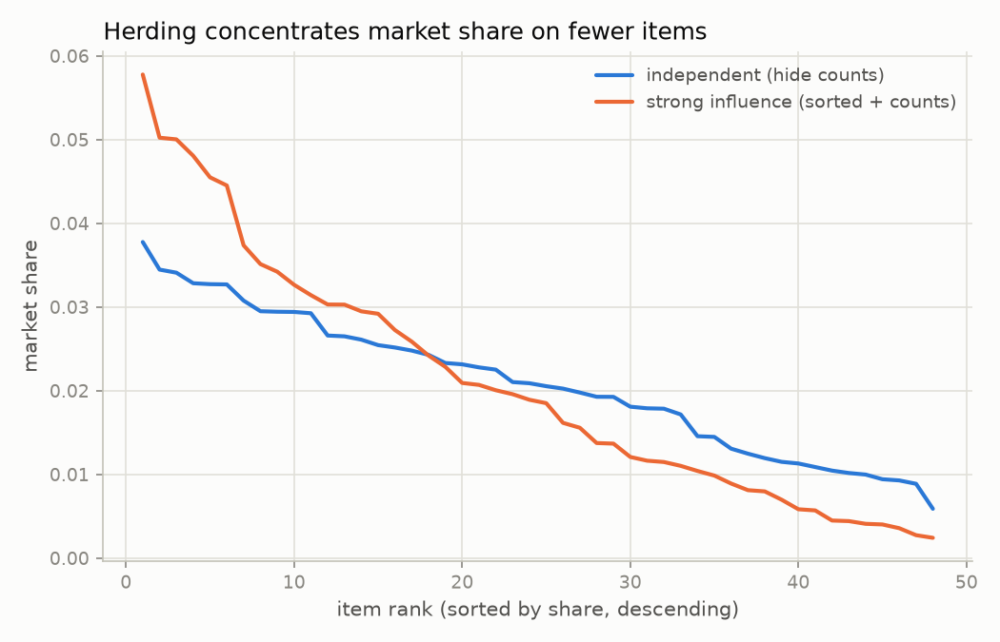

# herdlock

A small, seeded, non-LLM simulator of a "show agents the crowd's counts"
voting/selection panel, built to measure how much that single design choice
locks in early luck — and which cheap protocol changes undo it.

## Source

The idea comes from a summary by [@randhir302 on X](https://x.com/randhir302/status/2114188841888391359)
of Hashemi, Ji, Chen, Macy, *"LLM Multi-Agent Systems Are Vulnerable to
Herding and Runaway Cascades"* (arXiv:2610.30769). That paper replays Salganik,
Dodds & Watts' 2006 "Music Lab" experiment with LLM agents: 48 unfamiliar
songs, each agent picks a handful to assess and then says yes/no to each; in
"weak influence" worlds agents see cumulative **recommendation counts**
(cumulative prior yes-votes) in random order, in "strong influence" worlds
the list is additionally sorted by count. (The original 2006 human-subject
Music Lab study used *download* counts as its visible signal; the LLM
replication's agents see recommendation counts instead — this repo follows
the LLM paper.) They ran 1 independent world plus 8 weak and 8 strong worlds
per model, and reported: herding, unpredictable winners across parallel
worlds, early movers (the first ~30 agents) predicting the final ranking
better than intrinsic appeal does, little self-correction over time, a
reduced effect when the per-agent selection budget rises from 4 to 12, and no
reduction from lowering sampling temperature.

**This repository does not reproduce those numbers.** `herdlock`'s agents are
parametric (sigmoid-of-noisy-appeal), not LLMs — no API calls, no prompts.
It is a mechanism-level stress test: does *showing agents peer counts* alone
produce herding-shaped statistics in a cheap, fully synthetic model, and does
raising the per-agent selection budget (4 → 12) — the one mitigation the
paper itself tested and found reduces the effect — move these statistics the
same way here. **The budget sweep is the only mitigation taken from the
paper.** We also test two mitigations of our own invention, not proposed or
tested by Hashemi et al.: a "blind seed round" (`blind_first`, the first N
agents see no counts) and log-damped counts (`show="log"`). Sampling
temperature has no analogue in this parametric model, so that paper finding
isn't tested here. Treat the numbers below as evidence about this toy model,
not about LLM agents.

## The model

`herdlock/market.py`. K items get a fixed intrinsic appeal `a_k ~ Normal(0,1)`
once per market. `n_agents` arrive sequentially; each:

**1. Selects `budget` distinct items.** Let `c_k` be the number of prior
"yes" responses item `k` has received. Counts are visible unless the
condition is `independent`, or the agent index is below `blind_first` (a
mitigation); when not visible, the popularity share is uniform and
susceptibility has no effect. When visible, the displayed count is `c_k`
(or `log1p(c_k)` under the `show="log"` mitigation), giving a Laplace-smoothed
popularity share that equals `1/K` for every item whenever all `disp_k` are
equal — in particular at the all-zero start of a world:

```
sh_k    = (disp_k + 1) / (sum_j(disp_j) + K)
weight_k = (1 - s) / K + s * sh_k            # s = susceptibility in [0,1]
```

In the `strong` condition only, items are displayed sorted by current count
(ties random) and a fixed position-decay bias applies (`gamma = 0.98`,
position 0 = top of list): `weight_k *= gamma ** position_k`. `weak` shows
counts in random order — no position term. `budget` items are then drawn
without replacement with probability proportional to `weight`.

**2. Recommends yes/no for each selected item:**

```
taste_k  = a_k + Normal(0, tau)             # tau = 1.0
social_k = s * log(K * sh_k)                # 0 if counts not visible
P(yes_k) = sigmoid(taste_k + social_k)
```

`social_k` uses the *same* smoothed share `sh_k` as the selection step above,
and is exactly 0 whenever the market is at the uniform state (all `disp_k`
equal) — it is a neutral "are you above or below the uniform reference
share" signal, not a term that mechanically favors or penalizes an
average-share item. (An earlier version of this term used
`s * logit(share_k)` with `share_k = (c_k+1e-6)/(sum(c)+1e-6*K)`; that
formula is strongly negative, not zero, for any below-average item and was a
major undisclosed contributor to the headline numbers in a previous version
of this README — see [Note on the social-term fix](#note-on-the-social-term-fix) below.)

A "yes" increments `c_k` immediately, so later agents see updated counts
(sequential, as in Music Lab).

**Metrics** (`herdlock/market.py`): market share (counts normalized);
KL(condition‖independent) with Jeffreys smoothing (+0.5 per item before
normalizing); Gini of final shares; Pearson correlation of pooled shares vs.
a reference (either the true appeal, via `sigmoid(a_k)` as a proxy for each
item's true yes-probability share — a proxy, not exact, since taste noise
`tau=1.0` is not negligible and `E[sigmoid(a_k + noise)] != sigmoid(a_k)`; or
an independent baseline world); an early-mover correlation (shares from the
first 30 agents vs. shares from all later agents, pooled over worlds, split
by **chronological agent-arrival order**, not by item); unpredictability `U`
(mean over items of the mean pairwise `|share_j - share_k|` across all pairs
of W=8 parallel worlds); and a self-correction `delta_rho =
Spearman(second-half counts, independent counts) - Spearman(first-half
counts, independent counts)`, where "first half" / "second half" are also
split by chronological agent-arrival order (each agent recommends exactly
once per step, so this is equivalent to splitting the recommendation
sequence itself). Spearman is implemented with numpy ranks (ties averaged).

The independent-condition reference used for KL/correlation is one larger
independent world (2x the agents), as in the paper.

## How to run

```
./.venv/bin/pip install -e .[test]
./.venv/bin/pytest -q
./.venv/bin/python -m herdlock --out results
./.venv/bin/python examples/demo.py
```

`python -m herdlock --out results` writes `results/summary.json`,
`results/condition.csv`, `results/sweep.csv`, `results/mitigation.csv`, and
`results/herding.png`. Everything is deterministic given the fixed seed in
`herdlock/experiments.py` (K=48, 720 agents/world, budget=4, W=8 worlds,
default susceptibility=0.2). Runtime: under 6 seconds on a laptop, including
a cheap 5-seed robustness check (see below).

Pass `--markdown` to also print GFM tables straight from the full-precision
result floats (`round(value, 3)`, no intermediate display rounding) — this
is exactly how the tables below were generated, to avoid double-rounding
error between what's printed and what's in `summary.json`.

## Results

Generated verbatim by `./.venv/bin/python -m herdlock --out results --markdown`
(same run as committed in `results/`).

### condition

| condition | KL | U | Gini | corr_appeal | corr_independent | early_mover_corr | delta_rho | mean_yes_rate |
|---|---|---|---|---|---|---|---|---|
| independent | 0.027 | 0.004 | 0.245 | 0.897 | 0.838 | 0.391 | -0.031 | 0.509 |
| weak | 0.048 | 0.006 | 0.314 | 0.893 | 0.827 | 0.393 | 0.036 | 0.522 |
| strong | 0.137 | 0.009 | 0.435 | 0.812 | 0.744 | 0.603 | 0.094 | 0.571 |

### sweep

| susceptibility | KL | U | Gini | corr_appeal | corr_independent | early_mover_corr | delta_rho | mean_yes_rate |
|---|---|---|---|---|---|---|---|---|
| 0.0 | 0.068 | 0.007 | 0.347 | 0.857 | 0.792 | 0.459 | 0.097 | 0.544 |
| 0.1 | 0.087 | 0.008 | 0.384 | 0.846 | 0.797 | 0.544 | 0.089 | 0.561 |
| 0.2 | 0.132 | 0.009 | 0.433 | 0.822 | 0.751 | 0.621 | 0.088 | 0.571 |
| 0.3 | 0.176 | 0.01 | 0.472 | 0.783 | 0.72 | 0.622 | 0.079 | 0.582 |
| 0.5 | 0.416 | 0.016 | 0.614 | 0.673 | 0.595 | 0.753 | 0.116 | 0.624 |

### mitigation

| mitigation | KL | U | Gini | corr_appeal | corr_independent | early_mover_corr | delta_rho | mean_yes_rate |
|---|---|---|---|---|---|---|---|---|
| none | 0.122 | 0.009 | 0.428 | 0.83 | 0.782 | 0.613 | 0.078 | 0.575 |
| blind_first=100 | 0.102 | 0.008 | 0.411 | 0.847 | 0.809 | 0.455 | 0.048 | 0.566 |
| show=log | 0.078 | 0.007 | 0.369 | 0.859 | 0.794 | 0.539 | 0.069 | 0.556 |
| budget=12 | 0.086 | 0.005 | 0.402 | 0.918 | 0.859 | 0.725 | 0.05 | 0.567 |
| independent | 0.026 | 0.004 | 0.24 | 0.898 | 0.832 | 0.443 | 0.008 | 0.502 |

**Seed robustness** (`seed_robustness_check` in `herdlock/experiments.py`,
included in `summary.json`, run as part of every `python -m herdlock`):
reruns the condition table at 5 other appeal seeds (1, 2, 3, 42, 777;
n_agents=200, W=4, for speed) and checks the `independent < weak < strong`
ordering on both KL and Gini. Result: **held for 5/5 seeds tested.**

**A note on cross-table noise:** "strong, susceptibility=0.2, budget=4, W=8,
720 agents/world" appears in all three tables above (condition table, the
susceptibility=0.2 row of the sweep, and the "none" row of the mitigation
table) with three different KL values (0.137 / 0.132 / 0.122) and Gini
values (0.435 / 0.433 / 0.428) — about a 12% spread on KL and a 2% spread on
Gini. This is expected, not a bug: each table assigns a different per-table
world seed (`_seed()` in `herdlock/experiments.py`, keyed by `tag_id`), so
the three "identical" rows are drawn from genuinely different sets of worlds.



## What it means for agent panels

- **At the default susceptibility (s=0.2), showing counts has a real but
  modest effect, and most of it comes from sorting, not mere visibility.**
  Gini goes from 0.245 (independent) to 0.314 (weak, +28%) to 0.435 (strong,
  +77% over independent); KL goes from 0.027 to 0.048 (1.8x) to 0.137 (5.0x).
  Showing raw counts in random order (`weak`) barely moves early-mover
  correlation (0.391 → 0.393); sorting by count on top of that (`strong`) is
  what pushes it to 0.603. Mean yes-rate stays within a loose tolerance
  under `weak` (0.509 → 0.522) and is only mildly elevated under `strong`
  (→ 0.571) — the neutral social term (see below) is not itself suppressing
  or inflating acceptance the way an earlier, buggy version of it did.
- **The sweep shows where it actually bites.** At s=0.0 (no social term,
  only selection weighting) KL is 0.068; it roughly doubles by s=0.2 (0.132)
  and is ~6x the s=0.0 baseline by s=0.5 (0.416). The default s=0.2 is a
  comparatively mild point on this curve — herding in this model gets much
  worse at higher susceptibility than the headline condition table alone
  suggests.
- **No single mitigation wins on every metric.** Ranked by KL/Gini
  reduction from "none" (KL 0.122, Gini 0.428): `show=log` is best (KL
  0.078, Gini 0.369, a 36%/14% reduction), then `budget=12` (KL 0.086, Gini
  0.402), then `blind_first=100` (KL 0.102, Gini 0.411). But on
  early-mover correlation, the ranking flips: `blind_first=100` gives the
  lowest value (0.455, below even "none"'s 0.613), while `budget=12` is the
  *highest* of all five rows (0.725) — raising the budget concentrates
  outcomes less by the end of the run, but the agents who arrive early still
  predict that end state unusually well. Pick the mitigation that matches
  which failure mode you care about; none of the three dominates on all
  axes.
- **No evidence of reliable self-correction.** `delta_rho` stays small and
  mostly positive across every condition and mitigation (range: -0.031 to
  0.116) rather than reliably negative, so there's no sign here that
  strong-influence markets drift back toward the better-aligned outcome over
  time — nor a strong case that they reliably move away from it either.

## Note on the social-term fix

An earlier version of this model computed the social term as
`s * logit(share_k)` with `share_k = (c_k + eps) / (sum(c) + eps*K)`,
`eps=1e-6`. This is *not* neutral at the uniform reference point: for a
typical (average-share) item with K=48, `logit(1/48) ≈ -3.85`, so at s=0.2
every average item got a constant `-0.77` added to its acceptance logit
before any genuine amplification happened, and a zero-count item early in a
run could see `social` as low as -4, crushing its acceptance probability
toward 0 — an artifact of how `logit` blows up near 0, not a finding about
showing counts. This was flagged in an independent review and fixed by
switching to `s * log(K * sh_k)` with the Laplace-smoothed share described
above, which is exactly 0 whenever the market is at the uniform state. The
headline strong-influence numbers at s=0.2 dropped substantially as a
result: KL from 0.607 (old) to 0.137 (new, a ~4.4x drop) and Gini from 0.699
to 0.435. The `independent < weak < strong` ordering is preserved, but the
magnitude is far smaller than previously reported — the claims and numbers
throughout this README reflect the fixed formula.

## Limits

- Agents are a single parametric family (sigmoid of noisy appeal plus a
  neutral social-share term); this is not a model of LLM judgment, and there
  is no claim that its numbers match the paper's.
- One fixed appeal vector (seed 12345) is used for every table above;
  different appeal draws shift the exact numbers, but the
  `independent < weak < strong` ordering held in a direct check across 5
  other seeds (see "Seed robustness" above) rather than only an informal
  spot-check.
- The position-decay constant (`gamma=0.98`) and taste noise (`tau=1.0`) are
  fixed, documented choices, not fit to any real panel.
- `budget=12` is a mitigation genuinely tested in the paper (which found it
  reduces the effect); `show=log` and `blind_first` are this repo's own
  inventions, not from the paper. All three are tested only under strong
  influence at a single susceptibility value; we did not sweep mitigations
  × susceptibility.
- The social term is "neutral" only in the narrow sense of being exactly 0
  at the uniform state; it is not held to be perfectly neutral once a market
  has moved away from that starting point. Mean yes-rate under `strong`
  (0.571) ending up a bit above independent (0.509) is not an artifact of
  the social term itself, but of the selection-stage feedback loop: `strong`
  preferentially re-samples already-popular items, and popularity is
  correlated with genuine appeal, so the mean intrinsic appeal `a_k` of
  *selected* items under `strong` (0.39) is well above the market-wide mean
  (0.06), versus near-parity under `independent` (0.07 vs 0.06) — selection
  concentrates on genuinely better items faster than it concentrates on
  worse ones.
